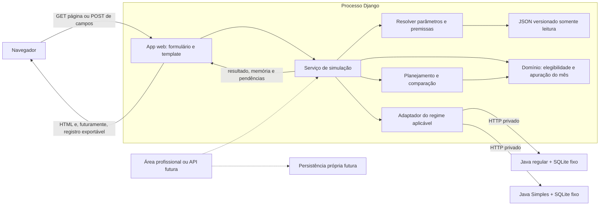

# Arquitetura da primeira versão web

[CÓDIGO] Na 02, `web.forms` valida a confirmação, `simulation.service` fixa o exemplo e coordena a chamada, `adapters.regular` controla admissão e prazo, `adapters.transport` usa Requests e `adapters.result` reconcilia itens e totais em Decimal. A JVM permanece ativa entre pedidos. A fronteira de transporte usa um processo Python descartável para permitir cancelamento de leitura bloqueada nos dois sistemas. [Ensaio e limites](PHASE_02.md)

[DECISÃO] Em 19/11/2026, a 00C adota um monólito modular Python/Django. Uma requisição chega ao formulário Django e retorna HTML já calculado. O núcleo Python recebe dados explícitos e pode ser exercitado offline. Só o cálculo por operação cruza a fronteira HTTP para um motor oficial. Na 01 basta a página inicial. [Recorte de produto](PRODUCT_SPEC.md) · [Plano da fundação](PHASE_01_PLAN.md)



| Componente e forma | Recebe → entrega | Limite de responsabilidade |
|---|---|---|
| `config`, pacote Django | Ambiente → configurações, URLs, WSGI | Monta os componentes e limita dependências. Só a web aceita dados do navegador |
| `web`, único app Django no MVP | Formulário em pt-BR → campos verificados → serviço → template com erros/resultado | Aplica CSRF, acessibilidade, localização de entrada e saída. Regras monetárias vivem no domínio |
| `simulation`, pacote Python | Pedido normalizado → recorte habilitado, manifesto fixado e cenários → resultados e próximas perguntas | Escolhe chamadas, controla orçamento e falhas locais, confere itens esperados e processados. Revalidar no servidor cada refinamento |
| `parameters`, pacote e dados JSON | Chaves legais e revisão → parâmetro ou impedimento. Premissas aceitas → hipóteses por cenário | Qualificação de fonte, vigência e conflito. Para o domínio os valores chegam com unidade, proveniência e revisão |
| `tax`, pacote Python puro | Históricos, parâmetros, eventos e valores de operação → faixa, DAS, contas por tributo, saldos e passos da memória | Funções determinísticas. Tempo, contexto decimal e fatos são entradas. Sem ORM, cliente HTTP, leitura de arquivos ou dependência de templates |
| `planning`, módulo Python | Meses e cenários → projeção e diferenças em perímetro comum | Encadeia receitas e saldos com a mesma revisão, verifica comparabilidade e solicita o que falta |
| `adapters`, módulos Python por contrato | Operação e manifesto → HTTP interno → resultados de item, avisos e memória original | Isola formato do fornecedor, timeout e versões. Jamais fecha o DAS. Os serviços Java podem ser iniciados separadamente |
| Persistência | Revisões e referências sintéticas → arquivos auditáveis. Dados econômicos anônimos → memória da requisição e formulário | Exportação sob controle do usuário. Somente um futuro caso de uso de histórico exigirá armazenamento de contas. [Contratos e retenção](DATA_MODEL.md) |

### Tecnologias que entram com cada fatia

[DECISÃO] Datas e versões de referência consultadas em 19/11/2026. Fixar as versões efetivamente instaladas e ensaiadas na fase correspondente. As tecnologias adiadas não integram o conjunto de instalação inicial.

| Tecnologia | Finalidade | A partir de | Justificativa | Alternativas | Decisão recomendada |
|---|---|---|---|---|---|
| CPython 3.14.10, venv, pip | Runtime portátil e Decimal | 01 | Série já presente na estação, patch estável de segurança, suportado por Django 5.2 desde 5.2.8 | 3.13 suportado, 3.15 fora da matriz da 5.2 | Usar 3.14 com patch fixado no README. [Python](https://www.python.org/downloads/release/python-31410/) · [Compatibilidade](https://docs.djangoproject.com/en/5.2/releases/5.2/) |
| Django 5.2.19 LTS | HTTP, formulários, middleware | 01 | Suporte estendido até abril/2028. O patch de 03/11 inclui correções de segurança | 6.1 com horizonte menor, Flask exigiria compor mais peças | Fixar 5.2.19 no corte e reavaliar patches ao abrir a fatia. [Suporte](https://www.djangoproject.com/download/) · [Release](https://docs.djangoproject.com/en/5.2/releases/5.2.19/) |
| Django Templates | HTML renderizado no servidor | 01 | Autoescape e mesmos formulários em GET/POST | Jinja, SPA | Incluir com Django |
| HTML semântico | Página e controles nativos | 01 | Navegação e submissão acessíveis sem cliente complexo | Renderização cliente | Adotar formulários e detalhes expansíveis nativos |
| CSS responsivo | Refluxo e leitura em celular | 01 | Uma folha estática é suficiente | Framework CSS | CSS local pequeno, sem pipeline |
| JavaScript nativo | Melhorias de foco/atualização | 03–05 se necessário | POST e HTML já permitem completar a tarefa | HTMX, navegação HTML | Só para interação cujo benefício seja testado |
| Git | Histórico de código, parâmetros e decisões | Atual/01 | Revisão de diff, referências por commit | Repositório de dados externo | Manter o repositório e excluir segredos e binários |
| Pytest 9.2.0 e pytest-django 4.14.0 (desenvolvimento) | Testes puros e cliente Django | 01 | Um executor para regra e HTTP, fixture de cliente e settings. Compatibilidade declarada do plugin | unittest e test runner Django | Fixar ambos só no conjunto de desenvolvimento. [Pytest](https://pypi.org/project/pytest/9.2.0/) · [Plugin](https://pypi.org/project/pytest-django/4.14.0/) |
| Java 21 LTS, SQLite oficial | Executar JAR/base do recorte | 02 | Preserva o caminho executado e o acervo da 00A | Reescrever regras ou usar piloto remoto | Reusar par qualificado, com base local de leitura |
| Requests 2.34.2 | POST/GET internos síncronos | 02 | Conexão e leitura com limites próprios, desativação de redirects e proxy do ambiente | urllib da biblioteca padrão, HTTPX | Adicionar com o primeiro adaptador. Controlar prazo global separadamente. [Distribuição](https://pypi.org/project/requests/2.34.2/) · [Timeouts](https://requests.readthedocs.io/en/latest/user/advanced/#timeouts) |
| Docker Engine | Isolar e reproduzir runtime Linux | Ensaio 02, aceite operacional 05 | JVM, sistema e caminhos influenciam o resultado | Processos nativos locais | Usar Engine suportado, fixar digest das imagens no ensaio. 01 funciona sem daemon |
| Docker Compose v2 | Orquestração local e rede privada | 02 para ensaio | Uma web e um motor bastam para a primeira prova | Comandos nativos | Começar pelo par web/regular, ampliar por perfil. [Rede](https://docs.docker.com/compose/how-tos/networking/) |
| SQLite próprio | Armazenamento local leve | Se aparecer escrita local | A fundação só precisa de uma página | Sem persistência ou PostgreSQL | Na 01 pode-se configurar `:memory:` para compatibilidade de ferramentas Django, sem tabelas de negócio |
| PostgreSQL | Escrita concorrente, histórico, isolamento | Área profissional ou necessidade comprovada | Custo de operar e migrar pressupõe dados a reter | SQLite próprio, arquivos | Adiar |
| HTMX | Atualização parcial do resultado | Após teste de UX | Mesma página funciona com submissão normal | HTML ou JS nativo | Adiar até atrito mensurado |
| Chart.js | Séries extensas | Planejamento ampliado | Tabela e cartões bastam para dois cenários | Tabela HTML | Adiar |
| Django REST Framework | API pública | Integrações futuras | Nenhum consumidor externo na primeira versão | Serviços Python internos | Adiar |
| Anotações Python, verificador estático | Delimitar tipos monetários, datas e estados | Anotações a partir de 02, verificador quando trouxer diagnóstico | Contratos curtos e datados têm uso concreto | mypy ou Pyright | Tipos padrão inicialmente |
| Ruff, formatação e lint | Uniformidade de código | A partir de módulos compartilhados, se necessário | Conjunto inicial é pequeno | Revisão e testes | Adiar ferramenta até haver regra de equipe ou erro recorrente |
| GitHub Actions | Matriz Windows/Linux | 02–05, quando útil e autorizado o uso remoto | Repetir instalação e testes offline em dois SOs | Execução local nos dois SOs | Planejar CI sem credenciais fiscais, sem enviar binários a serviço externo por padrão |
| Playwright | Navegador real, navegação e regressão | 05, antecipável se a 02 precisar | Cliente Django não cobre foco, layout ou navegação real | Ensaio manual roteirizado | Prova manual desde 01, automatizar o caminho crítico na consolidação |

React, Next.js e apps nativos acrescentariam outro cliente e distribuiriam lógica de apresentação. Kubernetes e microsserviços próprios exigiriam coordenação extra para um fluxo síncrono curto. Redis, Celery e filas distribuídas só teriam uso após medir contenção ou trabalho assíncrono. O MVP dispensa essas dependências.

## Duas estruturas, uma evolução

[DECISÃO] Estrutura **prevista** da 01, além dos documentos atuais. `web` é o único app. O ponto de entrada WSGI permite preservar o mesmo projeto quando chegar a fase de hospedagem.

```text
manage.py
config/
    __init__.py  settings.py  urls.py  wsgi.py
web/
    __init__.py  views.py
    templates/web/home.html
    static/web/site.css
tests/test_home.py
requirements.txt
requirements-dev.txt
pytest.ini
.env.example
.gitignore
README.md
docs/
```

Estrutura **prevista** do MVP, como acréscimo à anterior. Os nomes agrupam arquivos pela primeira função que realmente precisará deles. Módulos de pacote recebem `__init__.py` quando criados.

```text
web/
    forms.py
    templates/web/{operation,simulation,result}.html
simulation/
    service.py                 # coordenação e próximos dados
    contracts.py               # dados usados por mais de um módulo
adapters/
    regular.py                 # 02
    simples.py                 # somente com caso documental SN
tax/
    eligibility.py  simple_tax.py  monthly_accounts.py
    planning.py                # projeção e comparação
parameters/
    catalog.py  assumptions.py
reference/
    official/  assumptions/  releases/
tests/
    unit/  contract/  integration/  browser/
docs/evidencias/               # referências independentes e capturas sintéticas existentes
infra/                         # somente com ensaio Linux
    Dockerfile.web  Dockerfile.engine  compose.yaml
```

A 02 acrescenta formulário, serviço e adaptador regular. A 03 acrescenta o catálogo oficial, histórico e DAS quando a primeira soma mensal for necessária. A 04 acrescenta contas de créditos e comparação. Reaproveitar os casos da 00A/00B, inclusive para um adaptador do Simples se houver reconciliação documental SN. O domínio pode definir seus próprios tipos básicos, importáveis pelo serviço. A web nunca entra como dependência do domínio.

## Caminho da venda de março pelo sistema

| Passo | Entrada e componente | Saída observável |
|---|---|---|
| 1. Receber e normalizar | A web recebe POST de atividade, preço final de R$ 100 mil/mês e março/27. O serviço valida formato, idade, finalidade dos números e limites | Campos válidos em unidades canônicas, erros junto ao campo e triagem da revenda local |
| 2. Fixar cobertura e parâmetros | Serviço fixa revisão de código, catálogo, hipóteses e pares de motor permitidos. Resolver verifica data, território e classificação | Uma seleção por todo o pedido. IBS transitório com fonte, CBS regular sem nominal definitiva no corte. Divergência ou ausência ocupa uma rubrica identificada |
| 3. Construir cenários | Premissas distinguem série fiscal informada e média aceita. Serviço verifica situação no SN e opção de cada semestre | Tradicional e híbrido em contrafactuais identificados, preço, volume e mix comuns. Sem recibo, elegibilidade não confirmada |
| 4. Apurar tradicional | Domínio usa fev/26–jan/27, competência mar/27, Anexo I e faixa 4 | RBT12 de R$ 1,2 milhão, 8,825%, DAS bruto de R$ 8.825,00 e repartição. Zero chamadas aos motores. Extinções definem o que ainda falta pagar |
| 5. Formar bases do híbrido | Domínio e planejador usam preço, exclusões e débitos **da venda**. Se houver taxa hipotética aceita, abrir ramo distinto | Base regular e receita fiscal próprias. DAS remanescente de 7,457125% da receita fiscal desse cenário. Sem taxa ou exclusões suficientes, memória simbólica |
| 6. Detalhar uma operação se pedido | Adaptador traduz item e envia ao motor adequado. C03 usa nominal regular, C02 usa percentuais efetivos SN do mês. Conciliar item, documento e arredondamento | Na referência da 00B, um POST por regime ilustrado. Valores de item não se somam de novo ao DAS. Equivalência de amostra exige mesma base, local, mix, tratamento, peso, arredondamento e eventos. Sem prova, somente estimativa identificada |
| 7. Fechar contas | Domínio apura IBS e CBS separadamente, considera saldo anterior, apropriação e compensação datadas, tributos já extintos e saldo a transportar. Potencial do comprador tem titular e conta separados | Total próprio somente se todos os componentes estiverem cobertos. Crédito desconhecido mantém o bruto e impede o líquido. Exibir os cinco estados e registrar rubricas excluídas |
| 8. Comparar, apresentar e refinar | Planejador exige bases e escopos equivalentes. Web exibe mês, premissas, faltantes e memória. Usuário troca uma entrada e submete novo POST | Nova simulação recalculada. Para comparar a mudança de entrada, manter a edição anterior se ainda autorizada, senão explicar mudança e iniciar revisão separada |

No ano, o planejador avança mês a mês, transporta saldos e insere a receita fiscal de cada trajetória na janela correta. Mudança em março pode afetar o RBT12 a partir de maio. Confere o semestre de opção, faixa, atos e cobertura em cada mês. Um mês fora do catálogo deixa a projeção integral pendente. A exceção didática de R$ 105.900,00 anuais é a extrapolação do tradicional com os 12 meses, histórico anterior, receita e tratamento constantes descritos na 00B. A tela nomeia essas condições. [Memória e fórmulas](CALCULATION_REFERENCE.md) · [Regras](TAX_RULES.md) · [Contrato de resultados](DATA_MODEL.md)
